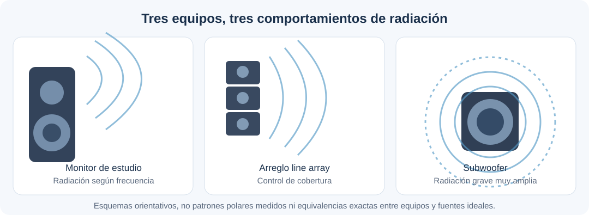
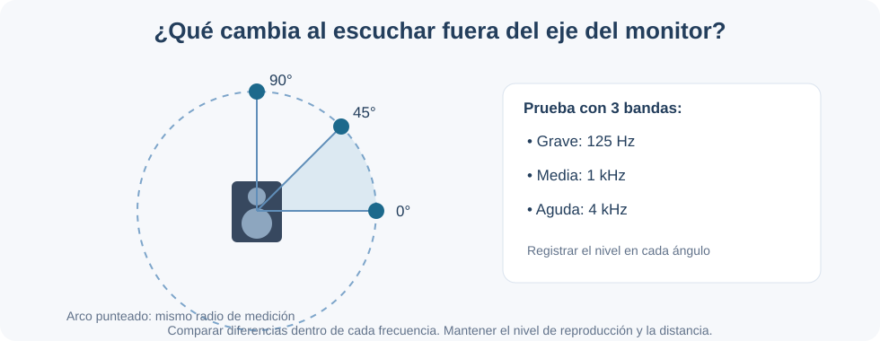

# Sesión 8: Tipos de fuentes sonoras y directividad

**Pregunta central:** ¿cómo influye la forma en que un equipo distribuye el sonido en nuestra escucha, grabación y sonorización?

Al terminar la sesión podrás **reconocer modelos de fuentes**, interpretar la **directividad** y tomar decisiones básicas sobre la **orientación de los monitores de estudio**.

---

## 1. Tipos de fuentes: tres modelos sencillos

Una fuente sonora real puede comportarse de manera diferente según su tamaño, la frecuencia y la distancia. En acústica usamos tres **modelos ideales** para comprender cómo se propaga la energía.

| Modelo | ¿Cómo se expande el sonido? | Caída ideal al duplicar la distancia | Ejemplo orientativo |
|---|---|---|---|
| **Puntual** | Frente esférico | **−6 dB** | Un altavoz pequeño observado a suficiente distancia y en campo libre |
| **Lineal** | Frente aproximadamente cilíndrico | **−3 dB** | Una línea ideal muy larga de fuentes; referencia conceptual para ciertos arreglos |
| **Plana** | Frentes de onda paralelos | **0 dB** por divergencia geométrica | Una onda plana ideal, por ejemplo dentro de un tubo adecuado |

!!! info "Importante"
    Son **idealizaciones**, no etiquetas rígidas para los equipos. Un *line array* real no mantiene siempre una caída de −3 dB; depende de su tamaño, frecuencia, disposición y distancia. En una sala también intervienen las reflexiones.

[🎛️ **Explorar la simulación: tres tipos de fuentes**](../../../simulacion/tipos-fuente.html){ .md-button }

**Observa:** ¿qué cambia al duplicar la distancia en cada modelo? Estudiaremos con más detalle la propagación y sus fórmulas en la **[sesión 9](../../U-2-propagacion-exterior/sesion-09/)**.

## 2. Directividad: ¿hacia dónde se dirige el sonido?

La **directividad** describe cómo varía la radiación de una fuente según la dirección. Un patrón polar muestra estas diferencias alrededor del equipo.

- **Omnidireccional (aproximado):** emisión relativamente uniforme en todas las direcciones.
- **Direccional:** mayor emisión en unas direcciones que en otras.
- **Fuera de eje:** posición situada a un lado del eje frontal del altavoz, donde la respuesta puede cambiar.

### ¿Por qué depende de la frecuencia?

La longitud de onda disminuye cuando aumenta la frecuencia:

\[
\lambda=\frac{343}{f}
\]

| Frecuencia | Longitud de onda aproximada | Qué recordar |
|---|---:|---|
| 125 Hz | 2,74 m | Los graves suelen tener radiación amplia en cajas pequeñas |
| 1 kHz | 34,3 cm | La directividad depende del transductor y la caja |
| 4 kHz | 8,6 cm | Es más probable observar diferencias entre el eje y los costados |

**Aplicación:** orientar los monitores hacia la posición de mezcla ayuda a escuchar una respuesta más consistente, especialmente en frecuencias medias y altas. La respuesta fuera del eje varía entre modelos.

[🔊 **Abrir simulación sonora: frecuencia y ángulo de escucha**](../../../simulacion/directividad-monitor.html){ .md-button }

En la simulación, mantén una frecuencia y mueve el control del ángulo de **0° a 90°**. Compara la atenuación ilustrativa y repite con otra frecuencia. **No es una medición real del monitor**: permite comprender la relación entre frecuencia, orientación y nivel.

## 3. ¿Cómo aplicamos esto a los equipos?

| Equipo | Aplicación en producción musical |
|---|---|
| **Monitor de estudio** | Orientar ambos altavoces hacia la posición de mezcla, a una altura apropiada y de forma simétrica |
| **Subwoofer** | Comprender su radiación grave generalmente amplia, pero comprobar su ubicación: los modos de sala pueden alterar mucho los graves |
| **Sistema PA / line array** | Elegir orientación y cobertura pensando en toda la audiencia, no solamente en el nivel de un punto |
| **Micrófono cardioide** | **Recibe** de forma distinta según la dirección: orientar su zona de menor sensibilidad para reducir sonidos no deseados |

!!! tip "Dos ideas que no deben confundirse"
    Un **altavoz** tiene un patrón de **radiación**; un **micrófono** tiene un patrón de **captación**. Ambos pueden ser direccionales, pero no cumplen la misma función.

### ¿Y los monitores «de campo cercano»?

Son monitores pensados para trabajar a distancias cortas, donde buscamos que predomine el sonido directo sobre las reflexiones. Esto **no significa** que todas sus frecuencias estén físicamente dentro del campo cercano de cada transductor. El campo próximo depende de la geometría, la frecuencia y el tipo de fuente.

## 4. Demostración: medir la directividad de un monitor

**Objetivo:** comprobar cómo cambia el nivel sonoro al escuchar un monitor en diferentes ángulos, **sin cambiar la distancia**.

**Materiales:** un monitor de estudio, computadora con generador de señales, micrófono de medición y analizador de espectro (ideal); como aproximación, sonómetro o aplicación móvil. Reproducir a **volumen moderado**.

**Procedimiento:**

1. Coloca el micrófono aproximadamente a **1 m** del monitor, a la altura del transductor de referencia. Mantén fija esa distancia respecto del punto de referencia de la caja.
2. Reproduce una banda de ruido estrecha centrada en **125 Hz, 1 kHz y 4 kHz**, una por vez; utiliza el **mismo nivel de reproducción** durante cada serie.
3. Para cada banda, mide a **0°, 45° y 90°**, desplazando el micrófono sobre un arco alrededor del monitor. Mantén el espacio lo más silencioso posible.
4. Registra los niveles y calcula la diferencia respecto a la lectura en 0°. Si solo dispones de un sonómetro, una alternativa es utilizar tonos individuales de bajo nivel, sabiendo que las reflexiones pueden alterar mucho la lectura.

| Frecuencia | 0° (dB) | 45° (dB) | 90° (dB) | Diferencia 90° − 0° |
|---|---|---|---|---|
| 125 Hz | | | | |
| 1 kHz | | | | |
| 4 kHz | | | | |

**Preguntas para discutir:** ¿en cuál de las frecuencias cambia más el nivel? ¿Qué consecuencias tiene para la orientación de los monitores y para la posición del oyente?

!!! warning "Alcance de la medición"
    Dentro del aula, las **reflexiones**, las dimensiones del monitor y el ruido de fondo pueden modificar los resultados; no esperes un patrón polar de laboratorio. Para obtener comparaciones rigurosas se necesitan equipos adecuados y condiciones controladas. Una aplicación de teléfono sirve como **demostración aproximada**, no como medición calibrada.

## 5. Resultados reales: mediciones de los tres grupos

En la práctica de clase, tres grupos midieron un mismo monitor a **0°, 45° y 90°**, con **tres lecturas AVG/Leq** por posición y bandas de ruido rosa filtrado. Los grupos utilizaron celulares diferentes, por lo que **comparamos cambios respecto a 0°**, no niveles absolutos entre dispositivos.

**Cómo leer los resultados:** para una frecuencia dada, resta el promedio a 0° del promedio a 45° o 90°. Si el resultado es negativo, el nivel disminuyó fuera del eje; si es positivo, aumentó. **Esta resta compara niveles**: no es la resta logarítmica utilizada para separar una fuente del ruido de fondo.

<iframe src="../../../simulacion/resultados-directividad.html" title="Gráfica interactiva de las mediciones de directividad de los tres grupos" loading="lazy" style="width:100%;height:780px;border:1px solid #cdd9e4;border-radius:12px;background:#fff;"></iframe>

[📈 **Abrir el gráfico interactivo en pantalla completa**](../../../simulacion/resultados-directividad.html){ .md-button }

### ¿Qué observamos?

- **125 Hz, Grupo 1:** casi no hubo variación a 90° (**+0,07 dB**).
- **500 Hz, Grupo 1:** el nivel **aumentó** a 90° (**+1,27 dB**). Las reflexiones, la geometría de medición y el espacio podrían influir.
- **4.000 Hz, Grupo 2:** el nivel cayó **−4,13 dB** a 90°.
- **6.000 Hz, Grupo 3:** apareció la mayor caída, **−7,40 dB** a 90°.
- **1.000 Hz** fue medido por los tres grupos, con diferencias distintas. Esto abre la discusión sobre repetibilidad, teléfonos y posición del micrófono.

!!! info "Interpretación de las mediciones"
    En conjunto se observa una tendencia compatible con **mayor directividad a frecuencias agudas**, pero **no una caída uniforme** en todas las bandas. Estos son resultados de una práctica en aula, afectados por reflexiones y por distintos micrófonos; **no equivalen al patrón polar calibrado del monitor**. Las líneas que unen los puntos en el gráfico facilitan su lectura y no representan frecuencias adicionales medidas.

---

**Idea final:** la cantidad de dB en un punto no explica toda la experiencia auditiva. También importa **en qué dirección** se distribuye el sonido y **cómo cambia con la frecuencia**.

*Referencia de consulta: Everest, F. A. y Pohlmann, K. C. (2009). Master Handbook of Acoustics, 5.ª ed., cap. 3. Para interpretar un equipo concreto, consulta sus mediciones polares y su documentación técnica.*
