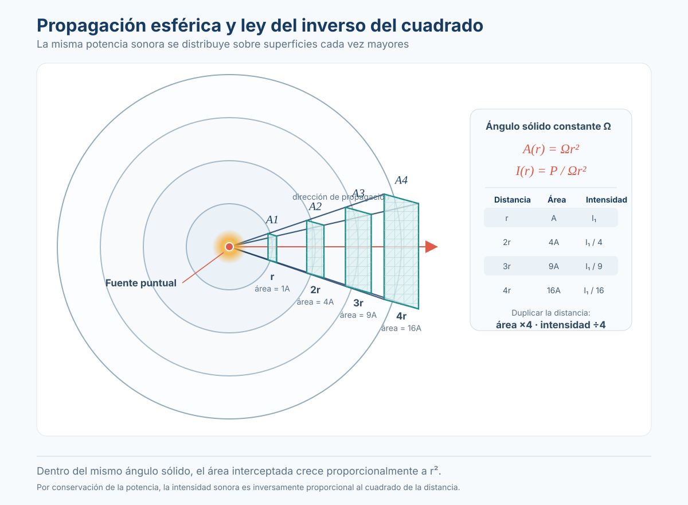

# Sesión 9: ¿Por qué disminuye el sonido al alejarnos?

**Pregunta central:** si un monitor reproduce el mismo sonido al mismo volumen, ¿por qué lo escuchamos más débil cuando nos alejamos?

**Al terminar la clase podrás:** explicar qué es el campo libre, aplicar la regla aproximada de **−6 dB por duplicación de distancia** e interpretar una medición real.

!!! tip "Conexión con la sesión 8"
    En la [sesión 8 estudiamos la directividad](../../U-1-fundamentos-medicion/sesion-08/index.md): **cambiamos el ángulo manteniendo la distancia**. Ahora hacemos lo contrario: **cambiamos la distancia manteniendo la dirección**.

## 1. Primero observamos: la energía se reparte

Imagina un monitor en un espacio abierto. Al alejarnos, **la fuente no deja de producir la misma energía acústica**; esa energía se distribuye sobre una superficie cada vez mayor.

**La idea esencial:** al duplicar la distancia a una fuente aproximadamente puntual, la energía sonora se distribuye sobre un área cuatro veces mayor. En condiciones ideales, la **intensidad** se reduce a una cuarta parte y el **nivel sonoro** disminuye aproximadamente **6 dB**.

### ¿Qué significa «campo libre»?

El **campo libre** es un modelo en el que el sonido llega desde la fuente sin reflexiones importantes del entorno. Para esta primera explicación también dejamos de lado la absorción del aire.

- **Aproximación práctica:** un espacio abierto y despejado, suficientemente lejos de superficies reflectantes.
- **Condición de laboratorio:** una cámara anecoica acústica, dentro de su rango útil.
- **En el aula:** el suelo, las paredes y el techo reflejan sonido. Por eso las mediciones no siempre coinciden con el modelo.

!!! info "No confundir"
    **Campo libre** significa que estudiamos la propagación sin reflexiones relevantes. **Campo cercano y campo lejano** describen regiones alrededor de la fuente. No son sinónimos.

## 2. La regla práctica: duplicar distancia = −6 dB

Supongamos que un monitor produce **90 dB SPL a un metro** en condiciones ideales, en una dirección fija.

| Distancia | Nivel esperado | Diferencia respecto a 1 m |
|---|---:|---:|
| **1 m** | **90 dB** | 0 dB |
| **2 m** | **84 dB** | −6 dB |
| **4 m** | **78 dB** | −12 dB |
| **8 m** | **72 dB** | −18 dB |

**Observa:** duplicar dos veces la distancia (de 1 a 4 m) supone dos caídas de 6 dB, es decir, una disminución total aproximada de **12 dB**.

La fórmula que resume la relación es:

\[
\boxed{L_2=L_1-20\log_{10}\left(\frac{r_2}{r_1}\right)}
\]

- \(L_1\): nivel conocido en la distancia inicial \(r_1\).
- \(L_2\): nivel estimado en la nueva distancia \(r_2\).

**Ejemplo sencillo:** de 1 a 2 metros, \(r_2/r_1=2\); como \(20\log_{10}(2)\approx6\), el nivel baja aproximadamente 6 dB. No necesitas memorizar el desarrollo algebraico para comprender la regla.

!!! warning "Cuándo funciona esta aproximación"
    La disminución de −6 dB por duplicación corresponde a la **divergencia geométrica de una fuente aproximadamente puntual**, en una dirección fija, en condiciones semejantes al campo libre y suficientemente lejos para aplicar este modelo. No es una ley que describa cualquier sala o cualquier sistema de altavoces a todas las distancias.

## 3. Simulación: mueve al oyente, no al monitor

En esta simulación el nivel inicial de **90 dB a 1 m es hipotético**. Mueve al espectador o presiona **«Duplicar distancia»** y observa el nivel calculado. También puedes escuchar una disminución **ilustrativa** de volumen, que no representa una medición calibrada.

<iframe src="../../../simulacion/festival-campo-libre.html" title="Simulación interactiva de la disminución del nivel sonoro con la distancia" loading="lazy" style="width:100%;height:920px;border:1px solid #d7e1eb;border-radius:12px;background:#fff;"></iframe>

[🎛️ **Abrir la simulación en pantalla completa**](../../../simulacion/festival-campo-libre.html){ .md-button }

**Dos preguntas:** ¿qué ocurre al pasar de 2 a 4 metros? ¿Y al pasar de 4 a 8 metros?

## 4. Práctica: ¿se cumplen los −6 dB en nuestra medición?

**Objetivo:** comparar una predicción de campo libre con mediciones reales hechas por los estudiantes.

### Materiales

- Un monitor de estudio conectado a la computadora.
- Un archivo de **ruido rosa filtrado alrededor de 1.000 Hz**, proporcionado por el docente (o ruido rosa de banda ancha).
- Un celular con Decibel X o una aplicación que muestre **Leq/AVG**.
- Trípode, cinta métrica y hojas de registro.

### Condiciones de medición

- Si es posible, trabaja en un **espacio abierto y despejado**; dentro del aula las reflexiones pueden ser importantes.
- Mantén el monitor y su volumen **fijos** durante toda la práctica, a nivel moderado.
- Coloca el micrófono a la **misma altura**, con **idéntica orientación**, siempre **frente al monitor (0°)**.
- Mide las distancias desde un **mismo punto de referencia de la caja** hasta el **micrófono del celular**.
- Utiliza **el mismo celular dentro de cada serie**. Mantén constante la ponderación (preferentemente Z, si está disponible).
- Reinicia el intervalo de **Leq/AVG** antes de cada medición; registra **15 segundos**.
- Comprueba que el sonido de prueba se encuentre claramente por encima del ruido de fondo. Si el entorno es muy ruidoso, los datos serán menos fiables.

### Procedimiento

1. Coloca el micrófono a **1 metro**, frente al monitor. Reproduce el audio y registra **tres mediciones**.
2. Sin cambiar el volumen, mueve el trípode a **2 metros** y realiza otras tres mediciones.
3. Repite a **4 metros**, si el espacio lo permite.
4. Calcula el **promedio de cada posición** y réstale el promedio obtenido a **1 metro**.
5. Compara la diferencia obtenida con el valor **ideal** de −6 dB a 2 m y −12 dB a 4 m.

| Distancia | AVG 1 | AVG 2 | AVG 3 | Promedio | Cambio respecto a 1 m | Cambio ideal |
|---|---|---|---|---|---|---|
| 1 m | | | | | **0 dB** | **0 dB** |
| 2 m | | | | | | **−6 dB** |
| 4 m | | | | | | **−12 dB** |

**Cómo hacer la resta:** si el promedio a 1 m es 82 dB y el promedio a 2 m es 77 dB, el cambio es **77 − 82 = −5 dB**. Es correcto restar directamente los dB aquí porque **estamos comparando dos niveles**, no separando dos fuentes de sonido.

!!! tip "Si no hay espacio para 4 metros"
    Realiza la comparación **1 m → 2 m** y discute su diferencia frente a los −6 dB ideales. No es necesario acercarse tanto al altavoz que el campo de sus distintos transductores complique la medición.

### Preguntas para interpretar

1. ¿Cuántos dB cambió realmente el nivel entre 1 y 2 metros?
2. ¿El resultado coincide con la disminución ideal de aproximadamente −6 dB? ¿Por qué podría ser distinto?
3. ¿Qué cambiaría si hiciéramos la medición al aire libre, lejos de paredes?
4. **Aplicación musical:** ¿por qué importa la distancia entre un altavoz de PA y los espectadores?

**Entrega:** tabla completa y **una conclusión breve** de 4 a 6 líneas. Se evalúa la calidad de la observación y la explicación, **no obtener exactamente −6 dB**.

## 5. Lo ideal frente a lo real

| Modelo ideal | Lo que puede ocurrir en un espacio real |
|---|---|
| No hay reflexiones relevantes | Las reflexiones pueden **reforzar o cancelar** ciertas frecuencias |
| Solo cambia la distancia | Puede variar ligeramente el ángulo, la altura o la orientación |
| La fuente se aproxima a un punto | Un monitor real tiene varios transductores y directividad |
| El ruido de fondo no interfiere | A mayor distancia, el ruido de fondo puede afectar más la lectura |
| Se ignora la absorción del aire | En exteriores y a distancias grandes pueden influir el aire, el viento y la temperatura |

**Conclusión de la sesión:** la regla de **−6 dB por duplicación** es nuestro punto de partida para comprender la propagación. Las mediciones nos ayudan a reconocer cuándo el modelo representa bien la realidad y cuándo intervienen otros factores.

??? info "Para profundizar: ¿de dónde sale la regla de −6 dB?"
    En una fuente puntual ideal que radia en todas direcciones, el área de la esfera aumenta como \(4\pi r^2\). Por tanto, la intensidad disminuye aproximadamente como:

    \[
    I\propto\frac{1}{r^2}
    \]

    Duplicar \(r\) divide la intensidad entre cuatro. La diferencia expresada en decibelios es:

    \[
    10\log_{10}(1/4)\approx-6,02\ \mathrm{dB}
    \]

    La presión sonora disminuye aproximadamente como \(1/r\) en el campo radiado de este modelo.

??? info "Ampliación técnica: potencia sonora (SWL), presión sonora (SPL) y directividad Q"
    La **potencia acústica** de la fuente (SWL) no es lo mismo que la **potencia eléctrica del amplificador**. Una relación aproximada en campo libre es:

    \[
    \boxed{L_p(r)\approx L_W+10\log_{10}\left(\frac{Q}{4\pi r^2}\right)}
    \]

    donde \(L_W\) es el nivel de potencia sonora relativo a \(10^{-12}\) W, \(L_p\) el nivel de presión sonora relativo a 20 µPa, \(r\) la distancia en metros y \(Q\) el factor de directividad en la dirección estudiada. Esta expresión utiliza las referencias habituales y una impedancia característica del aire cercana a 400 rayls; **no debe añadirse una constante de +10,8 dB**.

    Por ejemplo, con \(L_W=120\) dB, \(Q=2\) y \(r=20\) m, el cálculo ideal da **aproximadamente 86 dB SPL**. \(Q=2\) puede representar radiación hemisférica ideal sobre un plano perfectamente reflectante; no describe automáticamente cualquier altavoz colocado en un escenario.

    En un arreglo lineal ideal, la caída geométrica puede aproximarse a **−3 dB por duplicación**, pero un *line array* real no se comporta de ese modo a todas las distancias ni frecuencias.

??? info "Glosario mínimo"
    - **SPL:** nivel de presión sonora en un punto, expresado en dB SPL.
    - **dB:** unidad logarítmica para expresar relaciones de nivel.
    - **Leq / AVG:** nivel equivalente medido durante un intervalo.
    - **Campo libre:** modelo sin reflexiones relevantes.
    - **Divergencia geométrica:** distribución de la energía sobre superficies cada vez mayores.

---

*Referencia de consulta: Everest, F. A. y Pohlmann, K. C. (2009). Master Handbook of Acoustics, 5.ª ed., cap. 3.*
