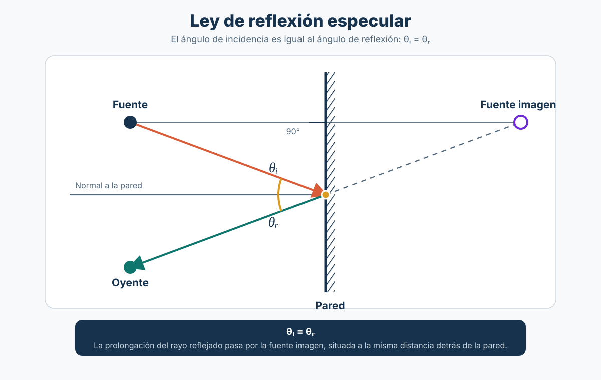

# Sesión 12: Aire, suelo y reflexión del sonido

**Pregunta central:** cuando escuchamos un sonido, ¿qué puede ocurrir durante su recorrido?

**Objetivo:** comprender tres fenómenos de propagación con ejemplos sencillos, antes de realizar una **prueba integradora de los conocimientos estudiados**.

## 1. ¿Por qué modelar el sonido como rayos? { #por-que-modelar-el-sonido-como-rayos }

Podemos dibujar **flechas o líneas** para representar el camino que recorre el sonido. A esas líneas las llamamos **rayos sonoros**.

Este modelo es útil para visualizar **hacia dónde viaja y dónde se refleja** el sonido, especialmente cuando las superficies son grandes comparadas con su longitud de onda. **No significa que el sonido sea literalmente un rayo:** sigue siendo una onda.

### El sonido se refleja

Si un rayo sonoro llega a una pared lisa y rígida, podemos representar su rebote como el de una pelota sobre una superficie:

- **Incidencia:** el rayo llega a la pared.
- **Reflexión:** el rayo sale después de rebotar.
- **Normal:** línea perpendicular a la pared. Los ángulos se miden **desde la normal**, no desde la superficie.

\[
\boxed{\text{Ángulo de llegada}=\text{Ángulo de reflexión}}
\]

**Ejemplo:** si el sonido llega con un ángulo de 30° respecto a la normal, sale con otro ángulo de 30° en la reflexión especular ideal.

## 2. Absorción atmosférica: ¿qué hace el aire?

Al recorrer grandes distancias, el aire absorbe parte de la energía sonora.

- Generalmente, la absorción acumulada resulta **más importante en los agudos** que en los graves.
- Su magnitud depende de la **frecuencia**, la **temperatura**, la **humedad** y las condiciones atmosféricas.
- No es lo mismo que la **divergencia geométrica** de la [sesión 9](../sesion-09/index.md): al alejarnos, la energía se distribuye sobre un área mayor y el nivel disminuye.

**Ejemplo:** un sonido muy lejano puede tener menos brillo que uno cercano. No toda esa diferencia se debe necesariamente a la absorción del aire: también influyen las fuentes, el entorno y la directividad.

## 3. Efecto del suelo: ¿por qué puede cambiar el sonido?

El suelo también puede **reflejar** sonido. Por eso, un oyente puede recibir dos contribuciones:

1. **Sonido directo:** llega desde el parlante.
2. **Sonido reflejado:** rebota en el suelo antes de llegar.

Cuando ambas ondas se encuentran, **pueden reforzarse o cancelarse parcialmente** dependiendo de la frecuencia, la diferencia de recorridos y las características del suelo.

**Ejemplo:** un suelo duro suele reflejar más sonido que uno poroso, pero no podemos afirmar que la reflexión siempre aumentará el nivel.

## 4. Demostración visual: los tres fenómenos

En esta actividad solo observaremos **qué hace el aire, qué hace el suelo y cómo se refleja un rayo sonoro**. Los esquemas son ilustrativos y no representan mediciones reales.

<iframe src="../../../simulacion/repaso-propagacion-sesion12.html" title="Demostración interactiva de absorción atmosférica, efecto del suelo y reflexión de rayos sonoros" loading="lazy" style="width:100%;height:1360px;border:1px solid #d7e1eb;border-radius:12px;background:#fff;"></iframe>

[🎛️ **Abrir demostración en pantalla completa**](../../../simulacion/repaso-propagacion-sesion12.html){ .md-button }

### En tres frases

| Fenómeno | Qué recordar |
|---|---|
| **Divergencia geométrica** (sesión 9) | Al alejarnos de una fuente aproximadamente puntual, disminuye el nivel. |
| **Absorción atmosférica** | El aire añade pérdidas que dependen de la frecuencia y las condiciones atmosféricas. |
| **Efecto del suelo y reflexión** | El sonido puede llegar por caminos distintos y producir refuerzos o cancelaciones. |

---

## 5. Prueba integradora de conocimientos

La parte principal de esta sesión se dedica a una **evaluación individual de los contenidos estudiados hasta la sesión 11**.

**Duración sugerida:** 60–70 minutos.

**Aspectos que debes dominar:** naturaleza y parámetros del sonido, frecuencia y longitud de onda, timbre y espectro, decibelios, niveles sonoros, suma de niveles, directividad, propagación con la distancia y factores que influyen en exteriores.

**Materiales:** calculadora y útiles de escritura, según las indicaciones del docente.

Las preguntas se entregarán **durante la evaluación** y no se publican en esta página.

## 6. Repaso posterior a la prueba: RMS, dBA y dBFS

En la prueba aparecieron tres conceptos que conviene diferenciar: **RMS**, **dBA** y **dBFS**. Se utilizan en audio y acústica, pero **no significan lo mismo**.

### 6.1. RMS: ¿cuál es el valor eficaz de una señal?

**RMS** viene de *Root Mean Square* (raíz cuadrática media). Es una forma de calcular el **valor eficaz de una señal que varía en el tiempo**. No es una unidad como los pascales o los decibelios.

Una onda sinusoidal oscila entre valores positivos y negativos. Si hacemos el promedio simple de una sinusoide completa, obtenemos cero; sin embargo, eso **no significa que la señal no tenga energía**. El cálculo RMS evita esa cancelación: eleva los valores al cuadrado, calcula su promedio y obtiene la raíz cuadrada.

Para una **sinusoide**:

\[
X_{\mathrm{RMS}}=\frac{X_{\mathrm{pico}}}{\sqrt{2}}\approx 0{,}707\,X_{\mathrm{pico}}
\]

**Ejemplo:** si una sinusoide tiene amplitud de pico de **1**, su valor RMS es aproximadamente **0,707** (en las mismas unidades de amplitud).

| Concepto | ¿Qué indica? | Utilidad |
|---|---|---|
| **Peak (pico)** | La amplitud máxima alcanzada. | Vigilar los picos y evitar la saturación digital. |
| **RMS (eficaz)** | El valor eficaz de la señal durante un intervalo. | Comparar niveles de señal y calcular la presión sonora eficaz. |

**Conexión con la acústica:** para calcular el **nivel de presión sonora (dB SPL)** se utiliza la **presión eficaz o RMS**, expresada en pascales.

!!! example "Para imaginarlo"
    Un golpe de caja puede alcanzar un **pico alto** y durar muy poco; una nota de órgano sostenida puede tener un **nivel RMS elevado** aunque su pico no sea tan alto. El valor RMS depende también del intervalo analizado.

### 6.2. dBA: ¿por qué no medimos todas las frecuencias de la misma manera?

Los **dB SPL** expresan el nivel de presión sonora con referencia a **20 µPa** en aire. Al aplicar la **ponderación A**, el instrumento modifica la contribución de cada frecuencia antes de calcular el nivel: el resultado se expresa en **dBA**.

La ponderación A **atenúa especialmente las frecuencias graves** y aproxima de forma simplificada ciertos aspectos de la sensibilidad del oído humano. **No equivale a medir directamente qué tan fuerte percibe una persona un sonido**, ni reemplaza las curvas de igual sonoridad que veremos en la [sesión 12B](../sesion-12b/index.md).

**Ejemplo ilustrativo con tonos puros:** si ambos producen **80 dB SPL**, la ponderación A arroja aproximadamente:

| Frecuencia del tono | Nivel sin ponderación | Nivel con ponderación A |
|---|---:|---:|
| **100 Hz** | 80 dB SPL | **61 dBA** |
| **1.000 Hz** | 80 dB SPL | **80 dBA** |

La diferencia aparece porque la ponderación A aplica cerca de **−19 dB a 100 Hz** y **0 dB a 1.000 Hz**. No se debe restar siempre una cantidad fija a los dB SPL: **depende del contenido en frecuencias** de cada sonido.

**Aplicación:** un sonómetro configurado en **dBA** permite evaluar niveles de ruido ambiental con un criterio de ponderación frecuencial estandarizado. Para analizar el contenido grave de un sonido, puede ser necesario utilizar otras mediciones.

### 6.3. dBFS: ¿qué mide el medidor de Ableton Live?

**dBFS** significa *decibels relative to full scale*: decibelios relativos a la **escala completa del audio digital**.

- **0 dBFS** indica la referencia máxima de amplitud de la escala digital convencional.
- **−6 dBFS**, en un medidor de **pico**, significa una amplitud aproximadamente igual al **50 %** del máximo digital.
- El silencio digital ideal equivale a un nivel de **−∞ dBFS**.

**Ejemplo en Ableton Live:** si el medidor de una pista marca **−6 dBFS de pico**, está mostrando el nivel de la **señal digital**, no el nivel de presión sonora que llega a nuestros oídos. Ese sonido podría reproducirse a niveles acústicos muy distintos según el volumen de salida, la interfaz, el amplificador, los parlantes y la distancia.

!!! warning "Error frecuente en la prueba"
    **−6 dBFS no equivale a −6 dB SPL.** Los dBFS usan una **referencia digital** y los dB SPL una **referencia física de presión**. Para relacionarlos hace falta conocer y calibrar toda la cadena de reproducción.

### 6.4. Comparación y comprobación rápida

| Término | Pregunta que responde | Ejemplo de uso |
|---|---|---|
| **RMS** | ¿Cuál es el valor eficaz de la señal? | Presión RMS para calcular dB SPL; nivel eficaz en audio. |
| **dBA** | ¿Cuál es el nivel acústico tras aplicar ponderación A? | Ruido de una sala medido con un sonómetro. |
| **dBFS** | ¿A qué nivel está la señal respecto al máximo digital? | Medidor de una pista en un DAW. |

**Comprueba que quedó claro:**

1. Una sinusoide de amplitud pico **2** tiene RMS de aproximadamente **1,414**. ¿Por qué no es 2?
2. Dos tonos de **80 dB SPL**, uno grave y otro de 1.000 Hz, ¿tienen necesariamente el mismo valor en **dBA**?
3. Si Ableton Live indica **−6 dBFS**, ¿podemos conocer los **dB SPL** que escucha el público sin medir la reproducción?

**Respuestas:** 1) porque RMS es el valor eficaz, no el máximo; 2) no, la ponderación A depende de la frecuencia; 3) no, falta conocer y calibrar el sistema de reproducción.

---

## 7. Video y práctica breve: del nivel digital al sonido en la sala

### Observación del video

Reproduce el siguiente video y toma nota de **una idea importante**, **un ejemplo concreto** y **una pregunta que te haya surgido**. Al terminar, discutiremos qué parte de la explicación se relaciona con los conceptos acústicos revisados en clase.

<iframe src="https://www.youtube-nocookie.com/embed/uCFqMfg7tM4" title="Video de referencia para la sesión 12 de Acústica Aplicada" loading="lazy" allow="accelerometer; autoplay; clipboard-write; encrypted-media; gyroscope; picture-in-picture; web-share" referrerpolicy="strict-origin-when-cross-origin" allowfullscreen style="width:100%;aspect-ratio:16/9;border:0;border-radius:12px;background:#111;"></iframe>

[▶️ **Abrir video directamente en YouTube**](https://www.youtube.com/watch?v=uCFqMfg7tM4){ .md-button }

**Para comentar después de verlo:**

1. ¿Qué fenómeno o concepto te pareció más importante y por qué?
2. ¿Qué ejemplo del video podrías relacionar con alguna medición o situación de producción musical?

### Práctica sencilla: ¿por qué dBFS no es dBA?

**Objetivo:** observar que el nivel digital de una señal y el nivel acústico de su reproducción son mediciones diferentes, y recordar cómo se calcula un valor RMS.

**Materiales:** computador con un DAW (por ejemplo, Ableton Live), altavoz o monitor y, si está disponible, un teléfono con aplicación de sonómetro que muestre **dBA**. La medición con teléfono será **solo orientativa**.

**1. Observa el nivel digital (dBFS).** Reproduce una señal o fragmento musical a **volumen bajo**. Mira el medidor de pico del DAW y anota un valor aproximado en **dBFS**. **No modifiques la ganancia de la pista ni del máster** durante la siguiente comparación.

**2. Compara lo que sale del altavoz (dBA).** Sitúa el teléfono siempre en el mismo punto, frente al altavoz, y observa el nivel aproximado en **dBA**. Luego modifica **solo el volumen físico del altavoz o de la interfaz**, manteniendo una escucha moderada. Observa de nuevo ambos medidores.

| Observación | Antes | Después de cambiar solo el volumen físico |
|---|---|---|
| **Pico digital (dBFS)** | Anota el valor | ¿Cambió? |
| **Nivel acústico (dBA)** | Anota el valor aproximado | ¿Cambió? |

!!! warning "Importante"
    **No busques niveles sonoros altos.** Una aplicación de teléfono no reemplaza un sonómetro calibrado y puede ser imprecisa, especialmente según la frecuencia. Esta comparación demuestra el comportamiento **relativo** de las lecturas; **no sirve para convertir dBFS a dBA ni para realizar una evaluación normativa de ruido**. Si no hay sonómetro, realiza la comparación auditiva sin asignar números de dBA.

**3. Comprueba el RMS con una sinusoide.** Supón que una onda sinusoidal tiene una **amplitud pico de 1 unidad**. Calcula su valor eficaz:

\[
X_{\mathrm{RMS}} = \frac{1}{\sqrt{2}} \approx 0{,}707
\]

Si reducimos la amplitud pico a **0,5**, ¿cuál sería su RMS? **Respuesta para contrastar:** aproximadamente **0,354** unidades. Tanto el valor pico como el RMS se reducen a la mitad.

**Cierre: tres conclusiones para escribir en una frase cada una.**

- ¿Por qué el valor en **dBFS** del DAW puede mantenerse aunque el sonido reproducido cambie de nivel?
- ¿Por qué una lectura en **dBA** depende del sonido que llega al micrófono y de su ponderación frecuencial?
- ¿Por qué **RMS** no significa lo mismo que **pico**?

---

!!! tip "Continuación: clase 12B — Psicoacústica"
    Después de estudiar cómo se propaga el sonido, exploraremos **cómo lo percibimos**: [Sesión 12B — ¿Escuchamos igual todas las frecuencias?](../sesion-12b/index.md). Incluye una práctica auditiva interactiva sin micrófono de medición.

---

**Para cerrar:** un modelo nos ayuda a entender el sonido, pero las mediciones reales también dependen del ambiente, de la fuente y del instrumento utilizado.

*Lectura opcional: Everest, F. A. y Pohlmann, K. C. (2009). Master Handbook of Acoustics, 5.ª ed.*
