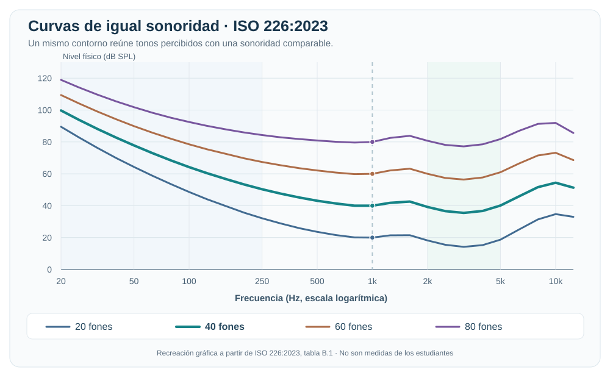
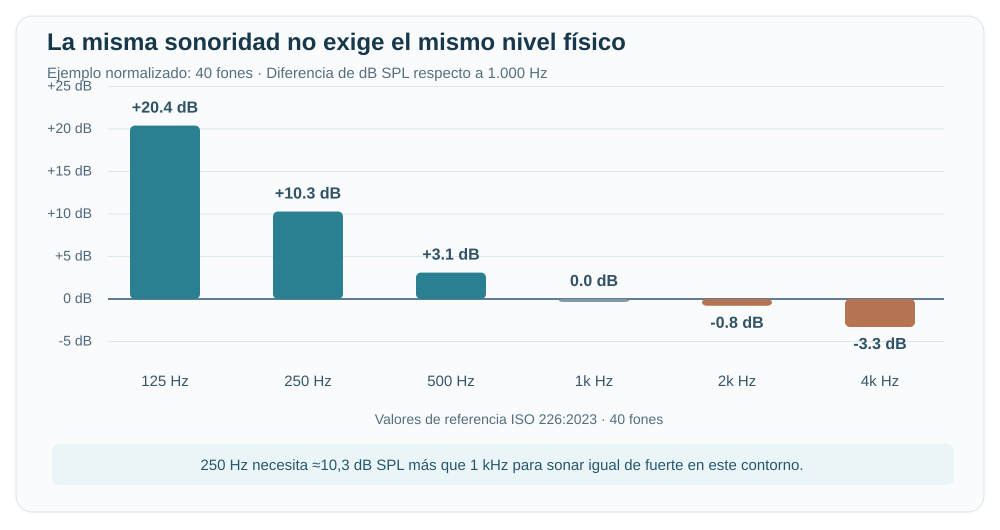

# Sesión 12B: ¿Escuchamos igual todas las frecuencias?

**Tema:** introducción a la psicoacústica y a las curvas de igual sonoridad.

**Pregunta central:** ¿por qué un tono grave puede parecer más débil que otro de frecuencia media aunque ambos tengan el mismo nivel físico?

**Al terminar podrás:** reconocer el rango audible humano aproximado, explorar cómo cambia la percepción al variar la frecuencia de un oscilador sinusoidal, distinguir frecuencia de sonoridad e interpretar las **curvas de igual sonoridad** mediante una práctica auditiva sin micrófono de medición.

## Antes de empezar: ¿qué frecuencias puede escuchar el ser humano?

En personas jóvenes con audición normal, se suele utilizar como referencia un rango aproximado de **20 Hz a 20.000 Hz (20 kHz)**. Este **no es un límite idéntico para todas las personas**: la sensibilidad auditiva varía con la edad, la frecuencia y el nivel del sonido. [Fuente: *The Audible Spectrum*, NCBI Bookshelf](https://www.ncbi.nlm.nih.gov/books/NBK10924/).

| Región aproximada | Frecuencias | Sensación habitual |
|---|---|---|
| **Infrasonidos** | Por debajo de 20 Hz | Fuera del rango tonal audible humano típico. |
| **Graves** | 20–250 Hz | Bombo, bajo, sensación de profundidad. |
| **Medios** | 250–4.000 Hz | Gran parte de la información de voces e instrumentos. |
| **Agudos** | 4.000–20.000 Hz | Brillo, detalles y componentes de alta frecuencia. |
| **Ultrasonidos** | Por encima de 20.000 Hz | Fuera del rango tonal audible humano típico. |

*Estos límites entre graves, medios y agudos son orientativos, no divisiones fisiológicas exactas.*

### Demostración con un oscilador sinusoidal

Una **onda sinusoidal** tiene una sola frecuencia y nos permite relacionar directamente los **Hz** con la altura que percibimos: al aumentar la frecuencia, el tono tiende a percibirse más agudo.

Utiliza este oscilador para **explorar frecuencias**, no para establecer un umbral auditivo individual. La escala superior muestra todo el rango teórico de 20 Hz a 20 kHz; la herramienta reproduce solo de **125 a 12.000 Hz**, donde los dispositivos de clase suelen responder con mayor previsibilidad.

**Procedimiento breve:**

1. Baja el volumen físico del equipo casi al mínimo. Selecciona **1.000 Hz** y pulsa «Escuchar tono»; ajusta el volumen solo hasta una escucha **suave y cómoda**.
2. Utiliza el control **Volumen del oscilador** para disminuir el nivel si lo necesitas y pulsa **«Fijar volumen para comparar»**.
3. Escucha brevemente **125, 250, 500, 1.000, 2.000, 4.000, 8.000 y 12.000 Hz** sin volver a aumentar el volumen. También puedes explorar frecuencias intermedias con el deslizador.
4. Para las frecuencias rápidas, registra **«Lo distinguí»** o **«No lo distinguí»**. **Si no escuchas una frecuencia, no subas el volumen para forzar su detección**.

<iframe src="../../../simulacion/rango-audible-oscilador.html" title="Exploración auditiva con oscilador sinusoidal, control de volumen limitado y mapa del rango de frecuencias" loading="lazy" style="width:100%;height:1540px;border:1px solid #d7e1eb;border-radius:12px;background:#fff;"></iframe>

[🎹 **Abrir el oscilador en pantalla completa**](../../../simulacion/rango-audible-oscilador.html){ .md-button }

!!! warning "Escucha responsable y límites de la demostración"
    **No es una audiometría ni una prueba para decidir «hasta qué frecuencia oye cada estudiante».** Si un tono no se distingue, pueden influir el nivel fijo utilizado, la respuesta de los auriculares, el parlante, la sala y otros factores. El control de volumen de la herramienta es **digital**, no mide los dB SPL que llegan al oído.

    Mantén un **volumen físico bajo**, evita escuchas largas y detente si hay molestias o zumbidos. Consulta las [recomendaciones de escucha segura de la OMS](https://www.who.int/es/news-room/questions-and-answers/item/deafness-and-hearing-loss-safe-listening).

**Para conversar:** ¿qué cambió principalmente al subir la frecuencia: la altura o la sonoridad? ¿Podemos afirmar que un estudiante tiene un límite auditivo determinado solo por este experimento?

---

## 1. De la acústica a la percepción

En las clases anteriores estudiamos fenómenos **físicos** del sonido: frecuencia, longitud de onda, decibelios y propagación. Ahora añadimos la experiencia de quien escucha.

La **psicoacústica** estudia cómo percibimos los sonidos y relaciona sus características físicas con nuestras sensaciones auditivas.

| Magnitud física | Lo que percibimos |
|---|---|
| **Frecuencia (Hz)** | Principalmente, la **altura** de un tono (grave o agudo). |
| **Nivel de presión sonora (dB SPL)** | Influye en la **sonoridad percibida**, es decir, qué tan fuerte nos parece. |
| **Espectro y evolución temporal** | Contribuyen al **timbre** de un sonido. |

!!! tip "Dos ideas diferentes"
    **Frecuencia no es sonoridad:** un sonido agudo no tiene por qué ser más fuerte que uno grave. La sonoridad depende del nivel, la frecuencia y otros factores perceptivos.

## 2. El oído no tiene la misma sensibilidad en todas las frecuencias

Imagina dos tonos puros, uno de **250 Hz** y otro de **1.000 Hz**, medidos con el mismo nivel de presión sonora. **No necesariamente se escucharán igual de fuertes**.

En términos generales:

- A niveles relativamente bajos, necesitamos un **nivel físico mayor en los graves** para que parezcan tan fuertes como un tono de referencia de frecuencia media.
- El oído humano suele mostrar una sensibilidad relativamente elevada en la región de aproximadamente **2.000 a 5.000 Hz**.
- Nuestra sensibilidad cambia con la frecuencia, el nivel de escucha y las características de cada persona.

### ¿Qué son las curvas de igual sonoridad?

Son curvas que muestran qué **niveles de presión sonora** deben tener diferentes tonos puros para que las personas los perciban con una **sonoridad semejante**.

Se conocen históricamente como *curvas de Fletcher y Munson*. La referencia normativa actual para condiciones específicas de escucha es la **[ISO 226:2023](https://www.iso.org/standard/83117.html)**.

### Gráficos estándar de referencia

**Gráfico 1. Curvas de igual sonoridad** (recreación didáctica basada en los valores tabulados de [ISO 226:2023](https://www.iso.org/standard/83117.html)).

**¿Cómo leerlo?** Sigue una sola curva —por ejemplo, la de **40 fones**— de izquierda a derecha. Aunque la **sonoridad percibida se mantiene aproximadamente igual**, los **dB SPL necesarios cambian** con la frecuencia. Por eso las curvas no son horizontales. Observa también que los contornos cambian de forma cuando varía el nivel de sonoridad.

**Gráfico 2. Una misma sonoridad de 40 fones, comparada con 1.000 Hz.**

Por ejemplo, dentro de ese contorno normalizado, un tono de **250 Hz requiere aproximadamente 10,3 dB SPL adicionales** respecto a uno de 1.000 Hz para percibirse igual de fuerte. Esto **no significa que debas obtener +10,3 dB en la práctica del navegador**: allí comparas ajustes digitales con auriculares o parlantes sin calibración.

!!! info "¿Bajo qué condiciones se obtienen los gráficos estándar?"
    [ISO 226:2023](https://www.iso.org/standard/83117.html) describe contornos medios para **tonos puros**, en condiciones normalizadas de **campo libre, incidencia frontal y escucha binaural**, con participantes adultos jóvenes de audición normal. Las gráficas son referencias científicas: **no son audiogramas individuales ni curvas medidas con nuestros dispositivos**.

**Referencia histórica:** la [Audio Engineering Society explica las curvas originales de Fletcher y Munson](https://aes.org/resources/audio-topics/loudness-project/learn-more/) y su importancia para la reproducción musical.

!!! info "¿Qué significa «fon» (*phon*)?"
    El **fon** es una unidad de **nivel de sonoridad**. Por definición, su valor numérico coincide con los dB SPL de un tono de **1.000 Hz** que se percibe igual de fuerte, bajo las condiciones de referencia.

    Un ajuste de volumen en **dB digitales no equivale a dB SPL ni a fones**. Para una comparación normativa se requieren condiciones controladas y mediciones calibradas.

### Una aplicación musical

¿Has notado que una mezcla escuchada **muy bajito** puede parecer menos potente en graves?

La respuesta del sistema auditivo depende del nivel de escucha. Por eso, en producción musical es útil revisar una mezcla **a volumen moderado y también a un volumen más bajo**, sin aumentar excesivamente la escucha para compensar los graves.

**No confundas:** la menor sensibilidad del oído a ciertas frecuencias **no es absorción atmosférica**. La absorción ocurre durante la propagación; la psicoacústica estudia la **percepción** del oyente.

## 3. Práctica: ¿qué tan fuerte escucho cada frecuencia?

**Objetivo:** comparar de manera **subjetiva** diferentes tonos con una referencia de 1.000 Hz y registrar cuánto ajustamos digitalmente cada tono de prueba para que parezca tener una sonoridad semejante.

### Materiales

- Computadora con navegador y la siguiente herramienta interactiva.
- **Audífonos** en buen estado (recomendados, no obligatorios) o el mismo parlante durante toda la serie.
- Hoja o documento para registrar las observaciones.

**No necesitas un micrófono de medición ni un sonómetro.**

!!! warning "Antes de escuchar"
    **Comienza con el volumen del equipo casi al mínimo**. Súbelo únicamente hasta oír cómodamente el tono de referencia. Mantén el mismo volumen físico durante toda la actividad y ajusta **solo el control de la simulación**. No fuerces el volumen para intentar igualar los sonidos, no realices escuchas prolongadas y detente ante cualquier molestia.

    Es una práctica educativa, **no una prueba de audición clínica**. Con auriculares o altavoces no calibrados, sus respuestas en frecuencia también influyen en el resultado.

### Laboratorio interactivo de sonoridad

1. Elige una frecuencia de prueba: **250, 500, 2.000 o 4.000 Hz**.
2. Escucha el tono **A de 1.000 Hz** y después el tono **B**.
3. Si B te parece más débil o más fuerte, modifica su **ajuste digital en dB**. Puedes alternar los tonos cuantas veces necesites.
4. Cuando ambos te parezcan igual de fuertes, selecciona **«Registrar igualación»**. Si no logras igualarlos cómodamente, marca **«No logré igualarlo»**.
5. Repite para las cuatro frecuencias y conserva una captura de la tabla y gráfica que se generan.

<iframe src="../../../simulacion/sonoridad-frecuencias.html" title="Práctica interactiva de comparación de sonoridad entre frecuencias" loading="lazy" style="width:100%;height:1550px;border:1px solid #d7e1eb;border-radius:12px;background:#fff;"></iframe>

[🎧 **Abrir el laboratorio de escucha en pantalla completa**](../../../simulacion/sonoridad-frecuencias.html){ .md-button }

### Ejemplo: sigue la curva estándar de 40 fones

**Después de realizar y registrar tu comparación**, vuelve al gráfico de 40 fones y observa esta tabla:

| Frecuencia | Nivel físico requerido en ISO 226:2023 | Sonoridad de referencia |
|---|---:|---:|
| **250 Hz** | **50,3 dB SPL** | **40 fones** |
| **1.000 Hz** | **40,0 dB SPL** | **40 fones** |
| **4.000 Hz** | **36,7 dB SPL** | **40 fones** |

**¿Qué significa?** Para que los tres tonos parezcan igual de fuertes bajo las condiciones normalizadas de ISO 226, el grave de 250 Hz necesita **más nivel físico** que el tono de 1.000 Hz, mientras que el de 4.000 Hz necesita **menos**.

**Dos preguntas para relacionar teoría y práctica:**

1. Si los tres tonos están en la misma curva de **40 fones**, ¿por qué no tienen el mismo valor de **dB SPL**?
2. Compara esta tendencia con tus ajustes digitales al escuchar: ¿coinciden o son diferentes? Explica por qué **no debemos esperar resultados idénticos** sin equipo ni niveles físicos calibrados.

!!! info "Dos tipos de datos: no los confundas"
    Los **50,3 / 40,0 / 36,7 dB SPL** de la tabla son **valores de referencia normalizados**. Tus resultados del laboratorio son **ajustes digitales relativos (dB)**, afectados por el equipo, el volumen de escucha y cada persona. **No representan un audiograma, fones medidos ni curvas de igual sonoridad obtenidas en clase.**

### Hoja de registro

| Tono de prueba B | ¿B sonaba más fuerte, igual o más débil antes de ajustar? | Ajuste digital para igualar A |
|---|---|---|
| **250 Hz** | | |
| **500 Hz** | | |
| **2.000 Hz** | | |
| **4.000 Hz** | | |

**Cómo leer los resultados:** si registras **+8 dB** en 250 Hz, significa que aumentaste **8 dB la amplitud digital relativa de ese tono** respecto a la referencia en tu equipo. **No** significa que tu oído tenga una pérdida auditiva de 8 dB ni que hayas medido una curva ISO.

## 4. Interpretamos los resultados

Responde brevemente:

1. ¿Qué tono necesitó el **mayor aumento digital** para parecer igual de fuerte que 1.000 Hz?
2. ¿Hubo algún tono al que tuviste que **reducirle** el nivel?
3. ¿Los resultados de dos compañeros fueron iguales? ¿Qué factores podrían explicarlo?
4. ¿Por qué debemos **evitar usar esta práctica para diagnosticar la audición** de alguien?
5. **Aplicación musical:** ¿qué puede cambiar en nuestra percepción de una mezcla cuando escuchamos a volumen muy bajo?

!!! tip "Conclusión esperada"
    El oído no responde de manera uniforme a todas las frecuencias. Sin embargo, la práctica también incluye la respuesta de los audífonos, el nivel de escucha, el entorno y las diferencias personales. **Sirve para experimentar e interpretar, no para obtener curvas normalizadas.**

**Entrega:** tabla de cuatro frecuencias (o captura de la simulación) y una **conclusión de 4 a 6 líneas**.

## 5. Cierre: tres ideas para llevarnos

- **Hz:** describe la frecuencia física de un tono.
- **dB SPL:** describe el nivel físico de presión sonora.
- **Sonoridad:** describe **qué tan fuerte percibimos** un sonido; no depende solo de los dB SPL.

**La pregunta que nos llevamos a producción musical:** ¿por qué es importante escuchar nuestras mezclas a niveles moderados y consistentes?

---

**Referencias y consulta**

- [Audio Engineering Society — Equal-loudness contours](https://aes.org/resources/audio-topics/loudness-project/learn-more/).
- [ISO 226:2023 — Acoustics: Normal equal-loudness-level contours](https://www.iso.org/standard/83117.html).
- [OMS — Escucha segura](https://www.who.int/news-room/questions-and-answers/item/deafness-and-hearing-loss-safe-listening).
